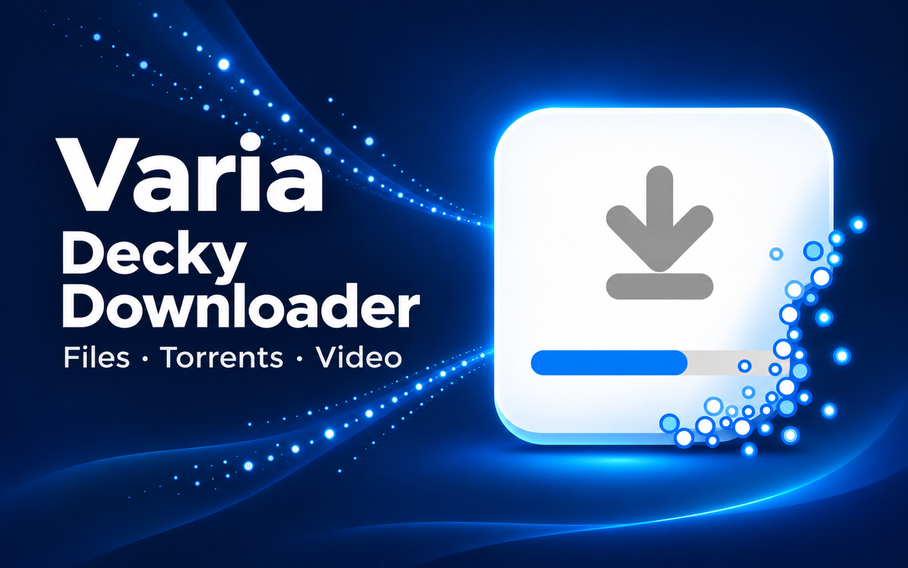
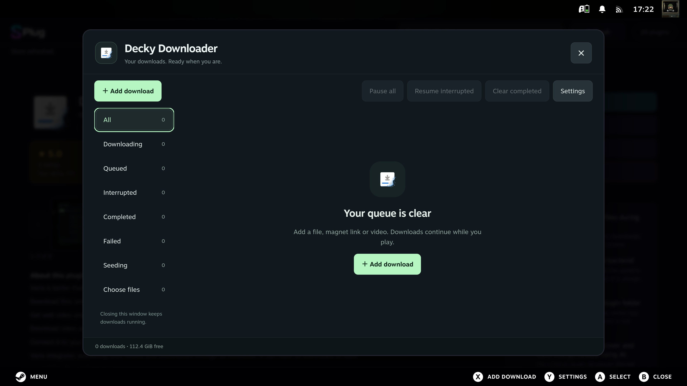
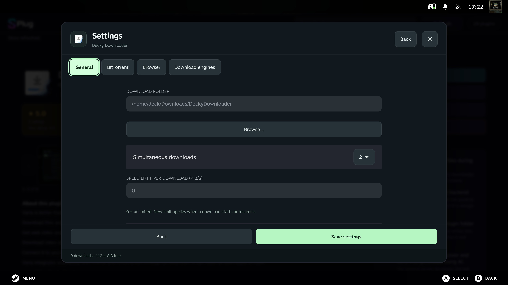
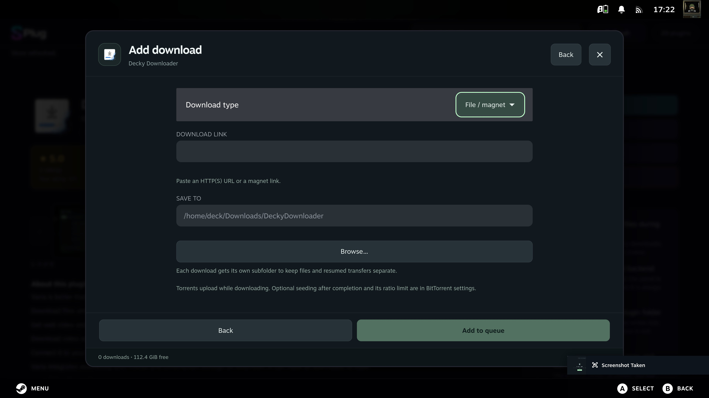
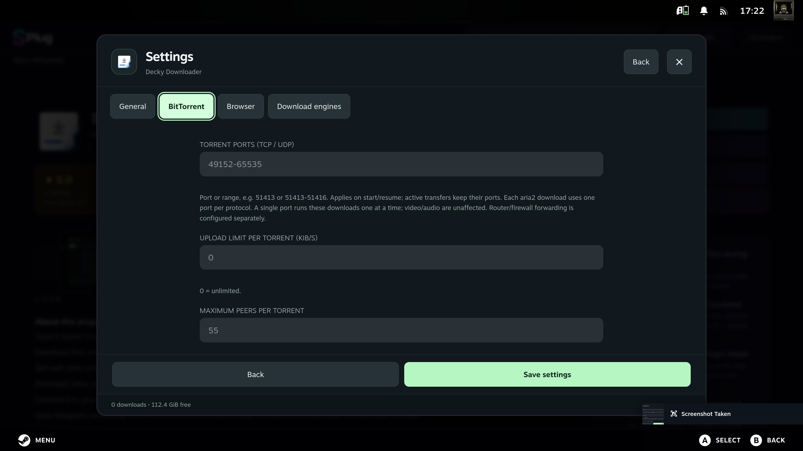
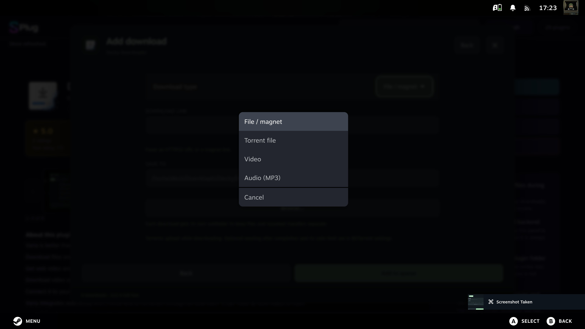
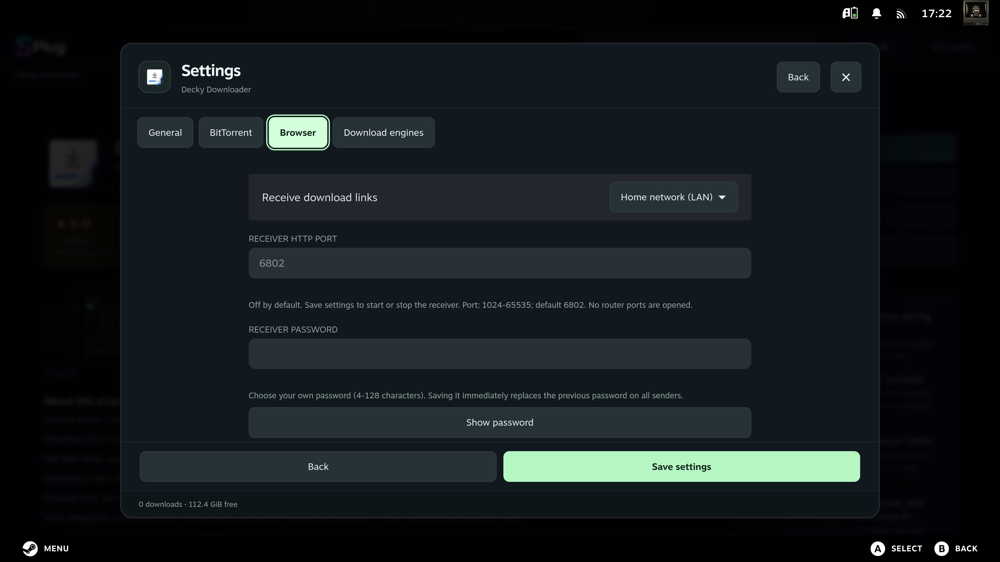
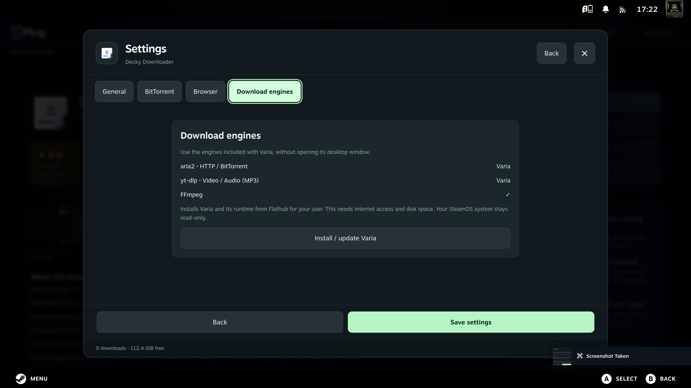
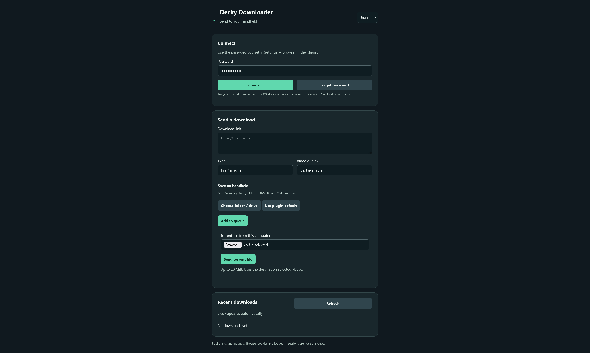

# Decky Downloader

### Your downloads, right inside Steam.

Download files, torrents, videos and music on your Steam Deck or gaming PC,
then get back to your game. Decky Downloader brings a download manager to
**SPlug and Decky Loader**, with controls for a gamepad, touch, keyboard and mouse.

**[Latest release: plugin and Firefox downloads](https://github.com/60plus/DeckyDownloader/releases/latest)** ·
[Firefox setup](browser-extension/README.md)

## Download what you need

- **Files and torrents**: paste a link or magnet, or open a `.torrent` file. Choose just the files you want before downloading.
- **Video and music**: save videos in your preferred quality or download audio as MP3.
- **A queue you control**: pause, resume interrupted transfers, retry failures and choose what downloads next.
- **A tidy download list**: remove one entry or clear completed downloads together. Your files stay on disk.
- **Your choice of storage**: save to internal storage, a mounted SD card or USB drive. Create folders without leaving the plugin.
- **Downloads during play**: closing the plugin window leaves transfers running while your device stays awake.

On a PC, the plugin opens in a window. On a handheld, it uses the full screen.
The interface is available in **English and Polish**.

## Screenshots

Explore the Steam interface and the companion web page. Click any screenshot
to view it at full size.

| Queue and downloads | Settings and sharing |
| --- | --- |
|  **Your download queue**: filters and quick actions in one place. |  **General settings**: choose a default folder, parallel downloads and speed limits. |
|  **Add a download**: paste a link and choose where it goes. |  **BitTorrent settings**: configure listening ports, upload limits and peers. |
|  **Choose your download type**: files, magnets, torrents, video or MP3. |  **Connect your browser**: enable home-network access and set your password. |
|  **Download engines**: install or update Varia's aria2, yt-dlp and FFmpeg runtime. |  **Send from your PC or phone**: paste links, upload torrents and choose a destination. |

## Send a link from your PC or phone

Found a file on another device? Send it straight to your handheld over your home
network. Open **Settings → Browser**, choose your own password and enable
**Home network (LAN)**. Open the displayed address in a browser and use the same
password to connect.

Paste a link, choose a folder on the handheld and follow the progress live.
No account or cloud service is needed.

The local page is also your remote download manager. Pause, resume, retry,
cancel or remove individual entries, move queued downloads to the front, resume
interrupted transfers and clear completed history. Filters and pages give you
access to the entire queue. **Remove** and **Clear completed** keep downloaded
files on disk; pause an active transfer before removing its entry.

Open **Settings** on the page for the same General, BitTorrent, Browser and
Download engines options as the plugin, including folder/drive selection,
seeding ratio and automatic yt-dlp updates. Changes stay in the form until you
save them. Changing the receiver port, mode or password may require reconnecting.

Have a `.torrent` file saved on your PC? Choose **Torrent file from this computer**
and press **Send torrent file**. Once the file list appears, mark what you want
and press **Download selected**. The same picker works for torrent links and
magnets: use **Choose torrent files** beside the download. You can also
**Pause and choose files** to change an active torrent's selection. Everything
works from the browser, without opening the plugin on the handheld.
Already have the torrent on your handheld? Use **Choose torrent on handheld**
to browse its folders and select the file there.

The optional **Firefox companion** also adds a right-click **Send link to Decky
Downloader** action. It remembers your chosen destination for subsequent links
and shows live progress in its popup. It includes the same torrent upload and
file picker; **Open in a tab** gives you more room. Keep the page or popup open
until an upload is acknowledged. Torrent uploads support v1/hybrid `.torrent`
files up to 20 MiB.
The companion also includes queue actions; **Open full manager and settings**
opens the local web page for configuration. Sign in there with the same password.

[Firefox setup instructions](browser-extension/README.md)

The Firefox download is currently an unsigned test ZIP, loaded temporarily
through `about:debugging`. The web page works without installing an extension.

## Make it fit your connection

Choose how many downloads run at once and set a speed limit. BitTorrent settings
include listening ports, upload limits, peer limits, DHT, PEX, local peer discovery
and required connection encryption. **UPnP is optional and off by default.**

### Choose torrent files and share back

New torrents first load their file list. Mark files with **A or touch**, use
**Select all / Clear selection** when helpful, then press **Download selected**.
For magnets, the list appears after metadata arrives from a peer. You can leave
the screen and return through the **Choose files** filter. To change a selection
later, pause the torrent and open **Choose torrent files** in its details.

In **Settings → BitTorrent**, enable **Seed after downloading** and set the
**Seed ratio limit**. Ratio **1** means uploading as much data as the selected
files contain; ratio **2** means twice that amount. Seeding is off by default.
The plugin shows upload speed and ratio, remembers uploaded bytes after a
restart, and stops sharing once the limit is reached. Pause a torrent to stop
sharing sooner. New downloads take priority over seeders.

**Choose files before downloading** can be turned off for new torrents when
you always want the entire torrent. Your existing file selections are kept.

Downloads keep their queue entries and partial data between sessions. After a
loader restart, use **Resume interrupted**. Open an individual download for its
resume, cancel and remove actions; those buttons remain below the details.

## Get started

1. Install through **SPlug** using this [source repository](https://github.com/60plus/DeckyDownloader),
   or install the plugin ZIP from the [latest release](https://github.com/60plus/DeckyDownloader/releases/latest)
   through your loader. SPlug can build `main` or the release tag shown there.
2. Open **Decky Downloader**. On first launch it sets up Varia's download engines
   automatically. Check **Settings → Download engines** for progress or to retry setup.
3. Choose **Add download**, paste a link or select a torrent, and pick a destination.
4. Start the download and return to your game. Open the plugin whenever you want
   to check progress or manage the queue.

Initial setup needs Flatpak, internet access and available storage. It installs
Varia for your user without changing SteamOS system files. Removing the plugin
leaves Varia and your downloaded files in place.

### Keep YouTube downloads up to date

If a video fails with HTTP 403 or an outdated yt-dlp warning, open
**Settings → Download engines → Update yt-dlp**, wait for the new version,
then retry the download. This installs the latest official yt-dlp separately
from Varia, whose bundled version can lag behind. The download is about 40 MiB
and its checksum is verified before activation. Varia continues to provide
FFmpeg and JavaScript support; new and resumed video/audio transfers use the
updated engine. A failed update keeps the previous selection.

To keep it current automatically, enable **Automatic yt-dlp updates** in the
same tab and **Save settings**. It is off by default. While the plugin is running,
it checks once every 24 hours and installs newer official releases. Failed
checks retry after one hour; restarting the loader preserves the schedule.
Up-to-date engines are not downloaded again. Disabling the option stops future
checks; an update already started may finish. The manual update button remains
available whenever you want to check immediately.

Updating fixes outdated extractors, but a video may still require login or
be restricted by YouTube. Browser cookies are not transferred automatically.

## Controls

| Control | Action |
| --- | --- |
| D-pad / left stick | Move between controls |
| A | Select or open download details |
| B | Go back; close from the download list |
| X | Add a download from the list |
| Y | Open settings from the list |
| LB / RB | Change the download list filter |
| Touch / mouse | Use the on-screen controls |

## A few things to know

- The receiving device must stay awake; downloads pause during sleep or shutdown.
- Removing a download from the list does not delete its files. Each transfer has its own subfolder.
- Resuming a file depends on support from the source server.
- Torrent pieces can span several files, so selecting one file may leave partial data for an unselected neighbor. Existing files are never deleted automatically.
- Browser sending is intended for a trusted home network. Cookies and logged-in browser sessions are not sent.

## About

Made by **60plus**, inspired by [Varia](https://github.com/giantpinkrobots/varia).
Decky Downloader is an independent plugin with its own Steam interface, powered
by aria2, yt-dlp and FFmpeg through Varia's runtime.

[Detailed setup and technical reference](docs/REFERENCE.md) ·
[Build and validation](docs/VALIDATION.md) ·
[Varia feature comparison](docs/VARIA-FEATURES.md) · [License](LICENSE)
